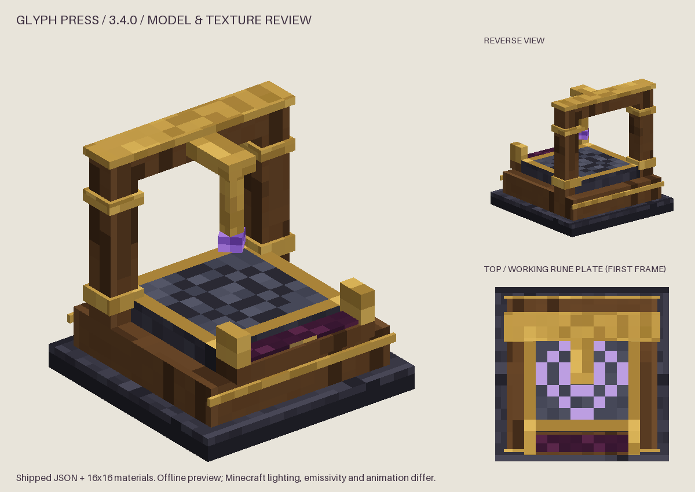

# The Glyph Press (3.4.0)

The Glyph Press turns a filled Iron's Spells 'n Spellbooks scroll into a real Ars Nouveau glyph
for that spell **at that level**. The glyph is knowledge: you learn it the normal Ars way (use
the glyph item), then add it to spells in your spell book like any other glyph. Each level of a
spell is its own glyph (`Firebolt I` to `Firebolt X`).

*Offline model render (`tools/preview_glyph_press.py`); in-game lighting, emissivity and the
animated rune plate differ.*

## Crafting

Block id `ars_n_spells:glyph_press`; substrate `ars_n_spells:blank_glyph_plate`.

| Recipe | Pattern / ingredients | Result |
| --- | --- | --- |
| Glyph Press (requires Iron's) | gold ingot, Source gem, gold ingot / archwood planks, lectern, archwood planks / obsidian x3 | 1 Glyph Press |
| Blank glyph plate | smooth stone + gold nugget + amethyst shard (shapeless) | 2 plates |

Both are datapack recipes (`data/ars_n_spells/recipes/`). The Press recipe carries a
`forge:mod_loaded irons_spellbooks` condition; the block itself is registered in every install,
so a placed Press never becomes an unknown block when Iron's is removed. The Press needs a
pickaxe and drops itself.

## Using it

| Slot | Holds | Used per conversion |
| --- | --- | --- |
| Scroll (top left) | one genuine filled Iron's scroll | the scroll |
| Plate (below it) | blank glyph plates | one plate |
| Catalyst (beside the plate) | Source gems (`#ars_n_spells:glyph_press_catalysts`) | the tier's count |
| Output (after the arrow) | the glyph | output only |

Press **Inscribe Glyph**. While a job runs the button reads **Cancel**. Nothing is consumed
until the glyph is finished: the job reserves its Source from the Press's buffer, locks the
three inputs (menu clicks, shift-click, number-key swaps, throws and hoppers alike), and at
completion takes one scroll, one plate and the gems, spends the reserved Source and inserts the
glyph in one step. Cancel returns everything untouched, Source included.

Default terms, all datapack-controlled (`config-reference.md`):

| Tier | Source gems | Source | Time |
| --- | --- | --- | --- |
| I | 1 | 500 | 5 s |
| II | 2 | 1,500 | 7 s |
| III | 4 | 3,000 | 10 s |

The tier is the glyph's Ars tier: Iron's own rarity for that level (Common is I, Uncommon and
Rare are II, Epic and Legendary are III) unless a datapack overrides it.

There is no random failure, quality roll or experience cost.

### Source

The Press holds 4,000 Source by default. While a job is waiting for Source it draws from
nearby Source jars (radius 4, every 20 ticks, loaded positions only, through Ars's own Source
lookup), taking only what the job still needs. An idle Press never looks for Source. Ars
Nouveau 4.12.7 relays bind only to Ars's own machines, so point relays at the jars beside a
Press rather than at the Press.

### What the screen shows

The scroll's spell, school and level with Iron's own spell icon (an ANS rune if the icon is
missing); the resulting glyph and its Ars tier, and whether you already know it; the costs and
what is in the press; the supported forms, augments and restrictions ("Self only", "Charges for
1.0 s"); the progress arrow and a Source gauge; and one clear reason when nothing can be done.
The result preview sits in its own dashed frame and is never an item in a slot. The **?**
button explains the Press; the details panel scrolls with the mouse or keyboard and is narrated.

### What it refuses, and why

Each refusal is shown on screen; nothing is consumed.

| Input | Message |
| --- | --- |
| no scroll | Insert a filled Iron's scroll. |
| any other item | Only a genuine Iron's scroll can be pressed. (It cannot enter the slot.) |
| a blank scroll, an empty container, the `none` spell | This scroll is blank. |
| a container with more than one slot or spell | This scroll holds more than one spell. |
| a level outside the spell's range | This scroll's level is not valid for its spell. |
| an Ars 'n' Spells export (Spell Loom carrier) | This scroll contains an exported Ars spell. |
| an Ars 'n' Spells proxy spell | This scroll holds an Ars 'n' Spells proxy, not an Iron's spell. |
| a spell Iron's or the server disables | Spell disabled by the server. |
| a spell Iron's makes you learn, not yet learned | You must learn this spell in Iron's first. |
| too few gems | Requires tier II catalyst materials: 2 Source gem(s). |
| a cost above the Press's capacity | Needs 3,000 Source, more than this press can hold (...). |
| a different item in the output, or a full stack | Output slot is full. |

The Press reads only Iron's own scroll item, strictly. Spell books, staffs, weapons and other
spell containers are not scrolls. Addon scroll items would need a deliberate reader.

## Automation and multiplayer

- Hoppers: the top face takes scrolls, the sides take plates and gems, the bottom extracts
  only the glyph. Unsided access may do both. A running job's inputs refuse every route.
- Automation can stage materials and take results but cannot start a job: starting is a
  player's action, so Iron's learning requirement is always checked against a real player.
- Two players looking at one Press see one job. Requests carry the menu, a fresh request id and
  the inventory revision the player saw; repeated, replayed or stale requests change nothing.

## Saving, breaking, reloading

- The inventory, Source buffer, job (identity, input fingerprint, reservation, progress) and a
  schema version are saved together. A loaded job resumes only if its inputs and the current
  data still plan it; otherwise it is cancelled with its items kept. A finished job is never in
  the save, so reloading never yields a second glyph.
- Breaking a Press (by hand, explosion or replacement) drops its contents once. A job in
  progress yields its original inputs, not a glyph. Stored Source is lost with the block.
- A `/reload` that changes a running job's price or disables its spell cancels it cleanly.

## Verified examples

Each example is a GameTest in `GlyphPressGameTests`, run in the profiles in `testing.md`:

- **Firebolt I** (the worn-notebook example): a level 1 Firebolt scroll, a plate, 1 Source gem
  and 500 Source make exactly one `Firebolt I` glyph in 100 ticks; exactly those are consumed
  (`ironsLoaded_bookExample_fireboltI_consumesExactlyItsCost`).
- **Firebolt IV**: tier II, 2 gems and 1,500 Source, the output is exactly level 4; one gem short
  is refused (`ironsLoaded_levelIsPreserved_atTierII`).
- Abyssal Shroud is refused until learned in Iron's; Cloud of Regeneration (disabled in Iron's
  by default) is refused even when a datapack allowlist names it.

## Commands

`/ans glyph inspect` tells you what the Press would make of the scroll in your hand (or
describes a held glyph). Operators have `/ans glyph press <pos>` for one Press's state, job and
Source, and `/ans glyph catalog|coverage|mappings`. No command converts scrolls: the Press is the
only conversion path.

## Limitations

- Only Iron's own `irons_spellbooks:scroll` item is read.
- Inventory automation cannot start jobs (by design; see above).
- Source held in a Press is lost if the block is destroyed.
- The screen, block model (idle and working) and glyph items were inspected in a scripted
  single-player client session (captures below); there was no manual survival playthrough or
  dedicated-server session (`testing.md`).

## In-game review captures

Scripted client session with Iron's 3.16.3, GUI scale 4 (`WorldUiSmoke`, `testing.md` run 7):

| Capture | Shows |
| --- | --- |
| [press-review/08-press-ready.png](press-review/08-press-ready.png) | A Firebolt I scroll, a plate and gems loaded; Iron's spell icon, tier, costs and the ghosted result preview |
| [press-review/09-press-help.png](press-review/09-press-help.png) | The help panel |
| [press-review/10-press-engraving.png](press-review/10-press-engraving.png) | A running job started through the real request packet: locked inputs, progress, Cancel |
| [press-review/11-press-working-world.png](press-review/11-press-working-world.png) | The block in the world with its lit rune plate |
| [press-review/12-press-done.png](press-review/12-press-done.png) | The finished glyph in the output; one plate, one gem and 500 Source used |
| [press-review/13-glyph-hotbar.png](press-review/13-glyph-hotbar.png) | Imported glyph items with Iron's icons and level markers |
