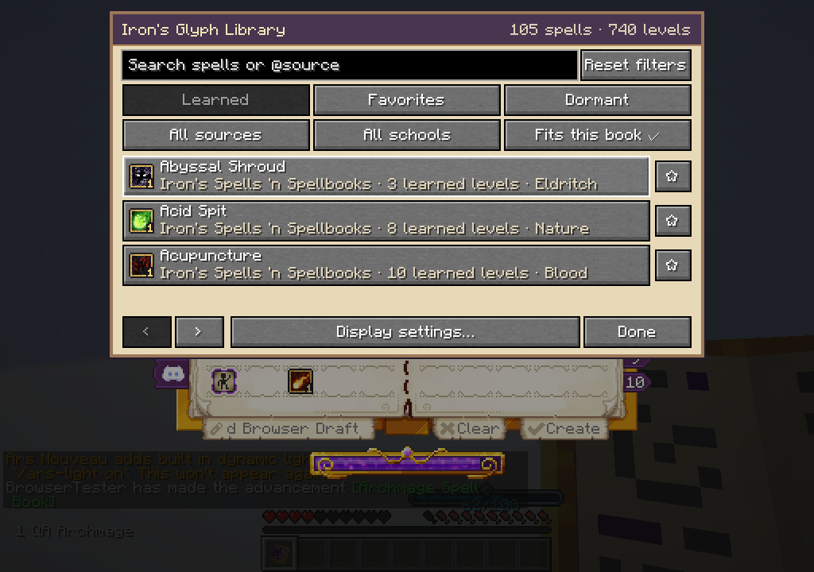
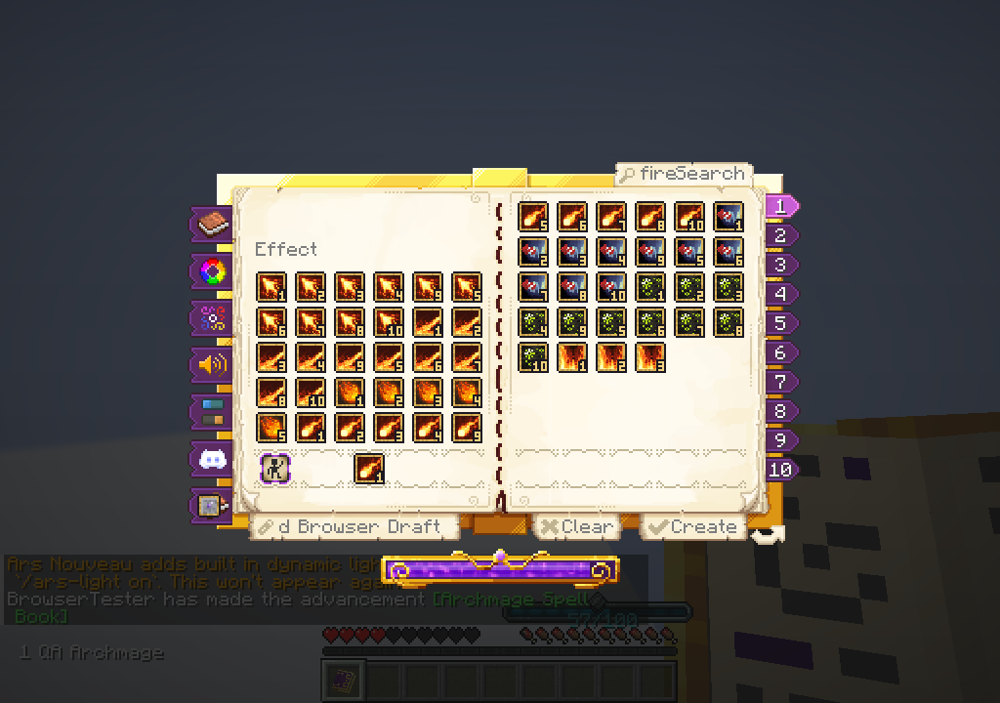
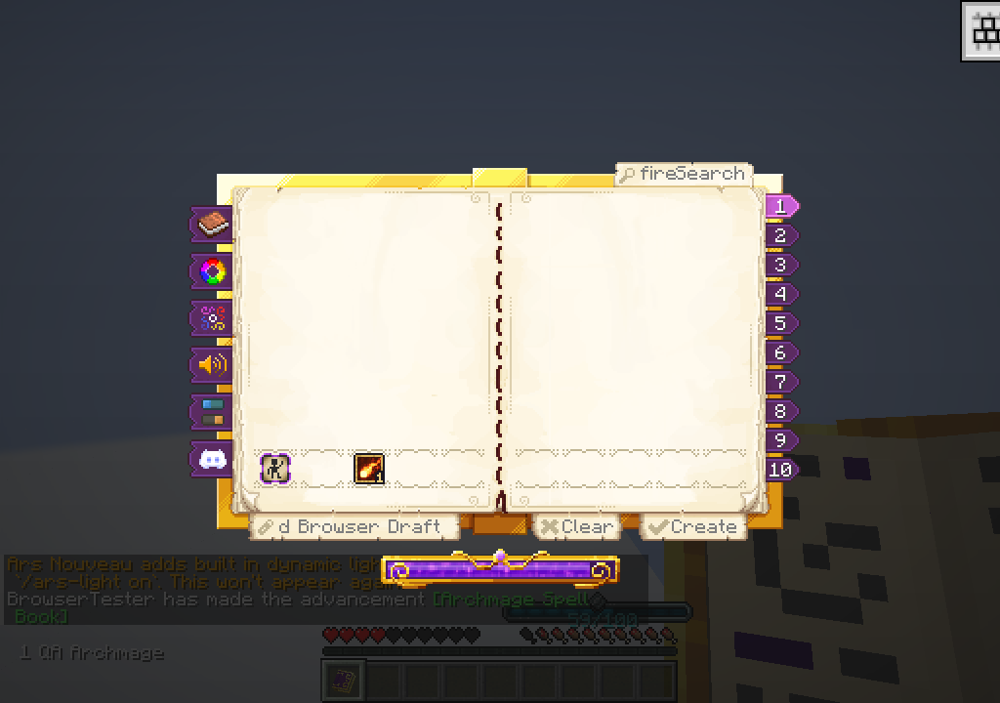
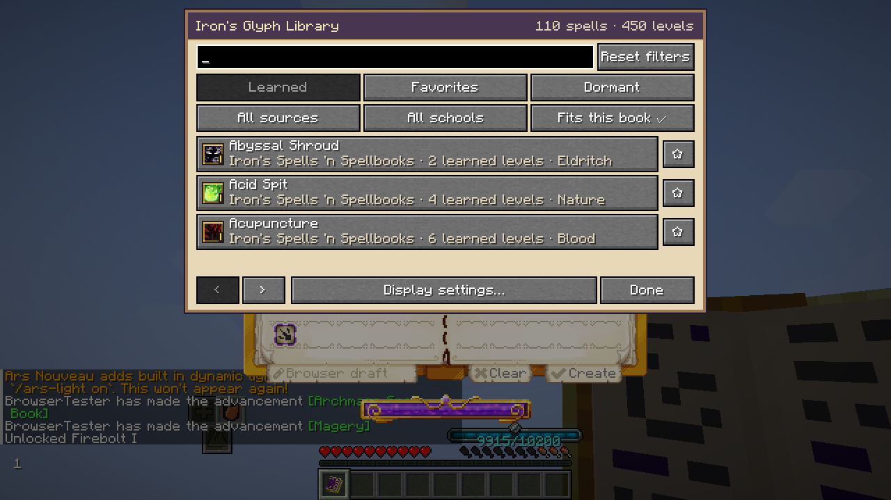
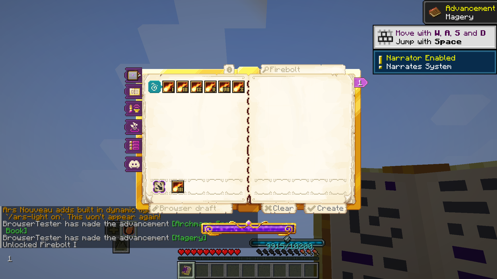
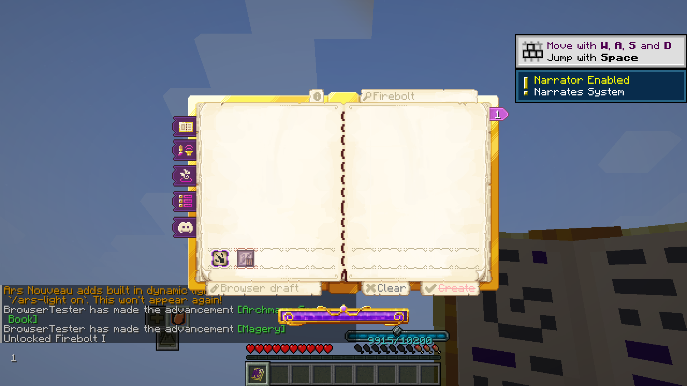

# Glyph library verification for 3.4.2

Tested on November 18, 2026 using the working release trees. Forge was on `main` at `6c26c544291ec3123eb1f5e97136d62d4d801b41`. NeoForge was on `port/1.21.1-neoforge` at `c234f19145d4380a849597f7e390fd535cc45e4f`. Both builds included the local 3.4.2 audit changes and the glyph library.

| Environment | Artifacts exercised |
| --- | --- |
| Forge | Java 17, Minecraft 1.20.1, Forge 47.4.10, Ars Nouveau 4.12.7 (CurseForge file 6688854). Iron's absent, 3.15.0 (7402504), and 3.16.3 (8680180). The packaged 3.15 client included JEI 15.20.0.135 and Curios 5.14.1. |
| NeoForge | Java 21, Minecraft 1.21.1, NeoForge 21.1.248, Ars Nouveau 5.13.1.1400. Iron's absent and 3.16.3. A separate client used Ars 5.13.5 (Modrinth file ALmdjtiq). The packaged client included JEI 19.21.0.247 and Curios 9.3.1. |
| Server agreement | NeoForge protocol 13 carries the effective lower level limit in the existing behavior snapshot. Both sides used 3.4.2. The accepted catalog had 111 original spells and 1,110 concrete IDs. |

Each release checkout produced `build/libs/ars_n_spells-3.4.2.jar`. The final Forge SHA-256 is `b7f689453eb83b6f044ebc8816f32f5d8f4e68b51cb600bcd35a2966578912e6`. The final NeoForge SHA-256 is `1910b592402c2a96f3adf64d17c9ac2f1639860428d0e991de810d843fd280b5`.

## Captured modes

The Organized captures show the learned library. The other captures show each native editor with an active query and its existing draft. Follow a thumbnail to inspect the full framebuffer.

| | Organized | Individual levels | Hidden |
| --- | --- | --- | --- |
| Forge | [](glyph-browser/forge-organized.png) | [](glyph-browser/forge-flat.png) | [](glyph-browser/forge-hidden.png) |
| NeoForge | [](glyph-browser/neo-organized.png) | [](glyph-browser/neo-flat.png) | [](glyph-browser/neo-hidden.png) |

## Observable results

| Scenario | Observation |
| --- | --- |
| Forge standard and Infinity editors | Both opened the grouped library, retained gaps, unsaved names and native search across resize, and exposed the expected candidates in all three modes. Synchronizing a changed capability reduced the fixture from 1,111 to 556 entries while the book was open. Both loaded profiles selected a real datapack recipe with a different ID from its glyph. |
| Packaged Forge client | The reobfuscated jar loaded in Forge's installer profile. The smoke finished both editors, all three modes and the real acquisition path, with 18 captures. Starting with `INVALID` in the TOML produced one value-correction diagnostic. The title-screen personal settings opened, reset, canceled and applied successfully. The marker and runtime jar digests are under `logs/glyph-browser/clients/forge-irons315/132256/` in the Forge test workspace. |
| External NeoForge config edits | The installed client recovered from `INVALID` to Organized with one value diagnostic. With the editor open and the draft named, an external write of `flat` exposed Firebolt III. Restoring `grouped` removed it from the native palette. The editor instance, draft and accepted client/server generation 2 survived both file-watcher events. The log contains `ANS_BROWSER_EXTERNAL_CONFIG_RELOAD` under `logs/glyph-browser/clients/neoforge-irons316/133629/`. |
| NeoForge ordinary acquisition and save | A real Firebolt I glyph item taught the player. A controlled bulk grant then supplied 666 imported identities plus Projectile, with deliberate gaps. The book search opened the library. Adding Firebolt III changed the correct draft cell. The held item stayed identical until native Create. Saving, reopening and native clipboard export returned Projectile followed by the exact Firebolt III identity. |
| NeoForge advanced editor | A 22-stage real-client probe exercised native pagination/search, favorite persistence, creative-book registry eligibility, low-tier and wrong-form rejection, a following-glyph limit violation, a sparse fifteen-cell draft, and a completely full bonus window. The grouped Scribe's Table chooser returned `ans_probe:firebolt_custom_b` for Firebolt IV. Individual levels showed both recipes and Hidden suppressed them. |
| Pending and live disable | Clearing and restoring accepted client facts exercised the loading state. A real integrated-server publication disabled and re-enabled imported glyphs during an edit. The server also published a Firebolt III tier override while the book was open. The client showed tier 3, excluded it from the novice filter and kept the draft element. An Add attempted after disable left the draft intact. A non-operator on a packaged dedicated server without Iron's retained the same 667 learned IDs and could inspect Dormant and select Hidden. |
| Personal data and gameplay boundaries | On the loaded NeoForge client, Organized and Individual levels both measured 2,100 maximum mana and 5.0 regeneration in the fixture. Knowledge, held stack and catalog hash were compared before native Save. The no-Iron's client had the same catalog identity digest, `d5cca028c8db1e41b267b2aad65f08a44014dfb28f8ed0ed8c70c1b56ecd67d8`. Decoding the persisted Ars attachment from integrated and dedicated saves gave 667 exact IDs with identical SHA-256 `dd21f18071890804f3203fb046509019daf9f249762d555c099337957fa6b613` (sorted IDs joined by a newline). The same saved Heal III in an ordinary archmage book restored a controlled two-health-point wound, charged 85 mana and started the native cooldown in each of Organized, Individual levels and Hidden. Existing GameTests also exercised mana contributions, glyph learning and prerequisites. |
| Keyboard, narration and JEI | The NeoForge client traversed forward and backward, opened a spell with Enter, added Firebolt III with Space and returned to the library with Escape. The real narration collector included the spell, source and Add label. The Linux narrator loaded with Flite 2.2. The Glyph Press category opened in JEI after the library session and the live server disable/enable cycle. |
| Two players and reconnect | Two actual NeoForge clients shared one published integrated world. The host kept Organized open while a non-operator guest used Hidden. They reported the same authoritative catalog. The guest restarted, reconnected with a new server-player entity and loaded Hidden from its own TOML. The host retained Organized. The isolated LAN server used offline authentication for the two local development profiles. |
| Archived world and restored Iron's | An installed 3.4.0 NeoForge client and server opened a disposable world without Iron's. That release saved 454 recognized glyph IDs for the test player. A copy of that same world opened on 3.4.2 with Iron's 3.16.3 installed. The player could browse and insert the previously learned Firebolt III, and its saved favorite became eligible. The sorted knowledge digest before and after the upgrade was identical at `5af356a93a5335a701b905a59d6f676622f1be38d975074403f1366cccc4dff5`. The historical save and restored run are in `logs/glyph-browser/upgrade/133330/01-server-3.4.0-absent/` and `logs/glyph-browser/upgrade/133521/`. |
| Respawn and a different server | The player died with the editor open. After a real respawn the old editor refused Add and reopening the book showed the replacement player's 454 learned glyphs. In the same process the client disconnected and joined a fresh server with imported gameplay disabled. Its learned list was empty, the Firebolt preference survived, and Favorites had zero eligible rows. The client log records `ANS_BROWSER_RESPAWN_PASS` and `ANS_BROWSER_SECOND_SERVER_PASS`. |
| Fallback | An unsupported NeoForge spellbook subclass kept the upstream imported palette. A replacement screen also stayed usable. Each client logged the unsupported editor once. |
| Display sizes | Clients exercised 1280×720 and 1920×1080, with GUI scales 3 and 4, as well as Forge resize cases. Row widgets, the level chooser and the Add control were exercised in the scaled book. |

### Automated checks

Both `build` tasks passed. The Forge JUnit report contained 1,105 tests and the NeoForge report contained 1,090. Each loader ran 14 browser and favorites cases, including parameterized shared fixtures. These exercised duplicate spell names, nonconsecutive and two-digit levels, unavailable/unknown favorites, stable ordering, translation changes, filters, empty pages, mode fallback and bounded JSON recovery.

| GameTest profile | Required passed | Optional scenarios executed | Optional scenarios gated |
| --- | ---: | ---: | ---: |
| Forge without Iron's | 372 | 1 | 308 |
| Forge with Iron's 3.15 and Ars Elemental | 372 | 268 | 41 |
| Forge with Iron's 3.16.3 | 372 | 259 | 50 |
| NeoForge without Iron's | 493 | 1 | 420 |
| NeoForge with Iron's 3.16.3 | 493 | 379 | 42 |
| NeoForge with Iron's, Ars Elemental, Ars Zero and Ars Elemancy | 493 | 401 | 20 |

Installed Forge dedicated servers reached Done and stopped cleanly without Iron's, with 3.15 and with 3.16.3. Installed NeoForge dedicated servers did the same without Iron's and with 3.16.3. Raw logs and resolved mod SHA-256 lists are in the Forge test workspace under `logs/glyph-browser/servers/`. The local parity comparison agreed on 70 shared cases in 75 files, 13 tool modules, 70 browser translation keys, 1,110 catalog identities and 1,110 ledger IDs. Python tooling tests passed (65 Forge, 59 NeoForge). Both icon verifiers and both pixel-generation checks passed.

The full source-inventory audit reported the same 489 differences recorded before this feature. Its complete list was compared with the pre-browser report, with zero new differences. The Forge-oriented `check_mod.py` reported zero Forge errors and one existing JEI warning. On NeoForge it flags the 1,110 runtime-generated icon sprites, NeoForge APIs and Minecraft 1.21 metadata as Forge 1.20.1 errors. The port's native asset checks and installed-client runs above cover those resources. [Earlier source-inventory and checker results](testing.md)

### Bounded work

On an Intel Core i7-13700HX, one Forge JUnit run built and queried 512 original spells with 4,096 known variants in 9.471 ms. A NeoForge run built and queried 1,024 original spells with 8,192 known variants in 7.679 ms. Each fixture filled its loader's registered-variant cap. These are individual JVM measurements for the pure model and query.

With the real 1,110-identity catalog, the loaded NeoForge fixture had 18 visible library widgets and the absent-Iron's fixture had 13. Across idle rendering both recorded zero catalog rebuilds and zero favorites-file writes. The loaded edit/save sequence observed five catalog builds, six with the additional tier override, and eight with both external config edits. The absent-server sequence observed three. The counts and timings can be found under `ANS_BROWSER_METRICS` in client logs and `ANS_BROWSER_STRESS` in the BrowserModelTest JUnit XML.

## Reproduce

Use a fresh game directory and a disposable survival world. For Forge name the world folder `ANS Glyph Browser QA`. For NeoForge name it `ANS Browser QA`. Copy the `ans_glyph_browser_smoke` directory from this checkout's test data into the world's `datapacks` directory before opening it. The probes equip real books and deliberately change the test player's knowledge. Each loader's datapack uses that Minecraft version's recipe format. [Recipe fixtures](../../tools/testdata/glyph-browser/ans_glyph_browser_smoke)

Run in the respective loader checkout.

```bash
./gradlew build
./gradlew runGameTestServer -PgametestRunDir=run-glyph-browser-absent
python3 -m unittest discover -s tools -p 'test_*.py'
python3 tools/contract_parity.py
python3 tools/generate_icons.py --check
python3 tools/verify_icons.py
```

For the Forge loaded profiles and editor probe, use these commands.

```bash
./gradlew runGameTestServer -PgametestRunDir=run-glyph-browser-loaded -PwithIronsRuntimeGameTests -PwithArsElemental
./gradlew runGameTestServer -PgametestRunDir=run-glyph-browser-irons316 -PwithIrons316RuntimeGameTests
./gradlew runClient -PgametestRunDir=run-glyph-browser-client-irons315 -PwithGlyphBrowserClientSmoke -PwithIronsRuntimeGameTests
```

For NeoForge, use a separate copy of the fixture world in each client profile. The interaction profile starts with empty favorites.

```bash
./gradlew runGameTestServer -PgametestRunDir=run-glyph-browser-ci-loaded -PwithIronsRuntimeGameTests -PwithArsElemental -PwithArsZero -PwithArsElemancy
./gradlew runClient -PgametestRunDir=run-glyph-browser-client -PwithGlyphBrowserSmoke -PwithIronsRuntimeGameTests
./gradlew runClient -PgametestRunDir=run-glyph-browser-interaction -PwithGlyphBrowserInteractionProbe -PwithIronsRuntimeGameTests
```

Use `tools/verify_gametest_log.py` against each profile's `logs/latest.log` with the expected counts above and the corresponding `--present` or `--absent` mod IDs. The cross-check runs from Forge with `python3 tools/verify_loader_parity.py --neoforge /path/to/neoforge-checkout --section behaviour`. Client success markers are `ANS_GLYPH_BROWSER_CLIENT_COMPLETE`, `ANS_BROWSER_CLIENT_PASS` and `ANS_BROWSER_INTERACTION_PASS`. Screenshots accompanying each client log are in `glyph-browser-review` or `glyph-browser-interaction-review`.

For the NeoForge two-player check, launch two client profiles with separate game directories. Give both the JVM option `-Dans.browserLanProbe.syncDir=/path/to/empty/shared-directory`. Start the host with `-Dans.browserLanProbe.role=host` and the guest as `LanGuest` with `-Dans.browserLanProbe.role=guest`. The host publishes the disposable world on loopback port 25939. When the first guest exits, relaunch it with the same profile and `-Dans.browserLanProbe.reconnect=true`. All three runs write `ANS_BROWSER_LAN_` completion markers.

For the historical-world check, use the pinned Ars version, a test player with hundreds of known glyphs including Firebolt III, and an archmage book containing Projectile. Log in, save and stop the archived server. Open a copy of the world with 3.4.2 and Iron's installed. Run a second 3.4.2 server with fresh player data and `enable_iron_glyphs = false`. Give the client a Firebolt favorite and set `-Dans.browserSmoke=true`, `-Dans.browserSmoke.address=127.0.0.1:25943` and `-Dans.browserSmoke.upgradePeer=127.0.0.1:25944` using the two servers' actual ports. Enable `keepInventory` and `doImmediateRespawn` on the upgraded world. When the client logs `ANS_BROWSER_UPGRADE_READY_FOR_RESPAWN`, use the server console to kill the test player once. Equip the replacement player with an archmage book on the second server. Compare the sorted glyph IDs in the original and upgraded saves after clean shutdown.

## Coverage limits

The original reporter's world and scroll addon were unavailable. The archived-world upgrade used disposable data and a known compatible mod set. Narration was exercised with the English client and the Linux speech engine. An acoustic assessment in other languages remains unverified.
